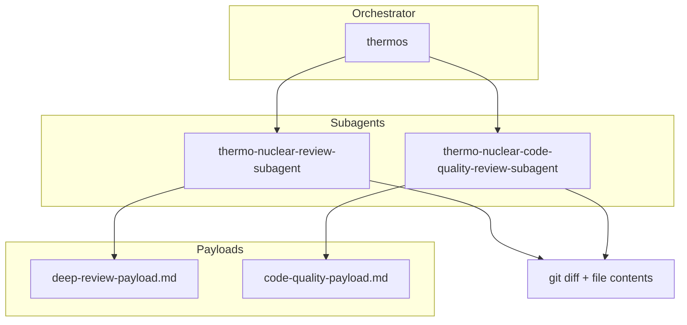

# @thinkscape/deepseek-harness-thermos


Thermo-nuclear branch review for DeepSeek Harness: deep correctness and
security audits, strict maintainability rubrics, and parallel subagent
orchestration.

Adapted from Cursor's MIT-licensed
[Thermos plugin](https://github.com/cursor/plugins/tree/main/thermos).

## Installation

```bash
npm install -g @thinkscape/deepseek-harness-thermos
deepseek-harness-thermos install
```

The package is published as
[`@thinkscape/deepseek-harness-thermos`](https://www.npmjs.com/package/@thinkscape/deepseek-harness-thermos).

The installer copies the `thermos` skill into the skill root of DeepSeek
Harness:

| Scope | Skill root |
|:--|:--|
| `--scope project` | `<git root>/.dsh/skills/thermos/` |
| `--scope user` | `$DSH_HOME/skills/thermos/`, or `~/.dsh/skills/thermos/` when `DSH_HOME` is not set |

The project scope finds the git root the same way the harness does, by walking
up from the current directory to the nearest ancestor that holds a `.git`. When
there is no such ancestor, the skill is installed into the current directory
instead.

The installer never writes into `~/.agents/skills/`, because that directory is
shared with other runtimes and a skill of the same name there would collide
with another host's skill.

Preview the plan without writing anything:

```bash
deepseek-harness-thermos install --dry-run
```

Remove an installed skill again:

```bash
deepseek-harness-thermos remove --scope user
```

## Primary invocation

```text
/thermos
```

The skill is user invocable only. It stays out of the model catalog, so
`/thermos` is its single entry point.

Inside the skill, DeepSeek Harness runs the two review passes as two parallel
`subagent` calls in one assistant message. Each reviewer receives the whole
payload for its pass, and the parent verifies the returned findings against the
changed lines before it reports them.

## Installed skill

| Path | Purpose |
|:--|:--|
| `SKILL.md` | The workflow the parent follows. |
| `references/deep-review-payload.md` | The payload of the deep correctness and security pass. |
| `references/code-quality-payload.md` | The payload of the strict code-quality pass. |
| `scripts/thermos-validate.mjs` | The validator that proves or drops every finding card. |

The parent reads a payload file, fills its three evidence sections with the
scoped diff, the changed file contents and the user's scope, and pastes the
result into that pass's prompt. The rubric and the finding report contract
travel inside the payload, so the two passes stay independent.

## Architecture



## Typical usage

1. Install the skill for the project or for the user.
2. Start DeepSeek Harness in the repository you want to review.
3. Type `/thermos` and, when useful, add a base ref, a PR URL or a scope.
4. Read the unified verdict and the verified findings.

## Attribution

This package adapts methodology, diagrams, and prompt structure from Cursor's
Thermos plugin. See the repository `NOTICE.md` for the upstream MIT notice.
